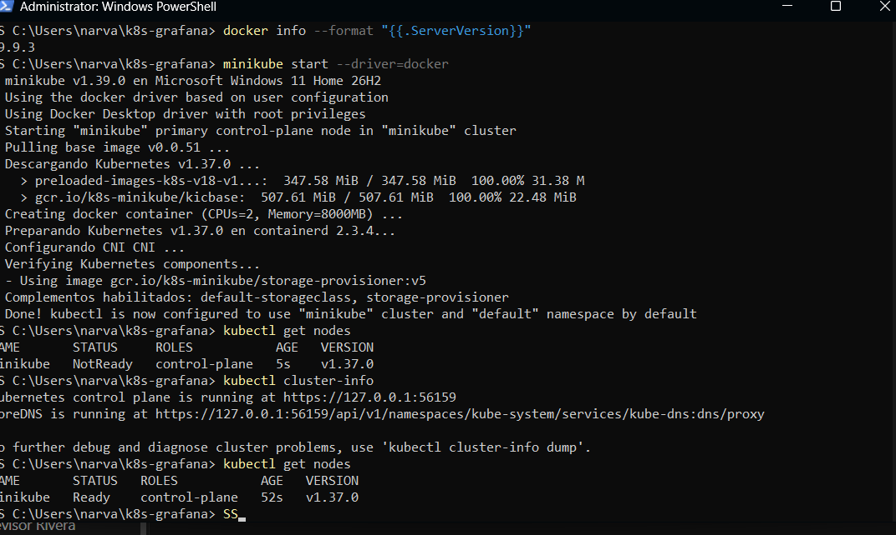
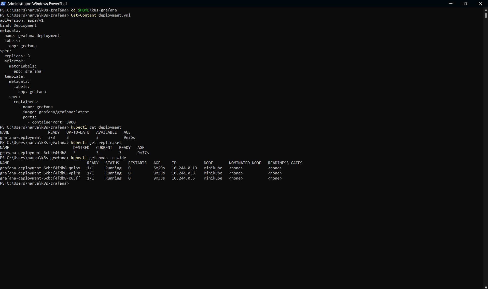
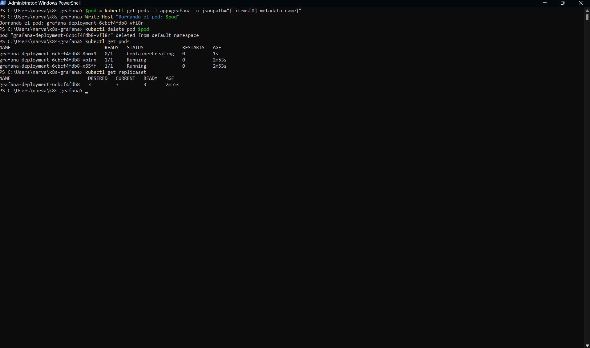
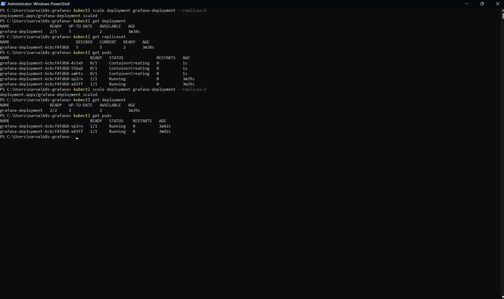
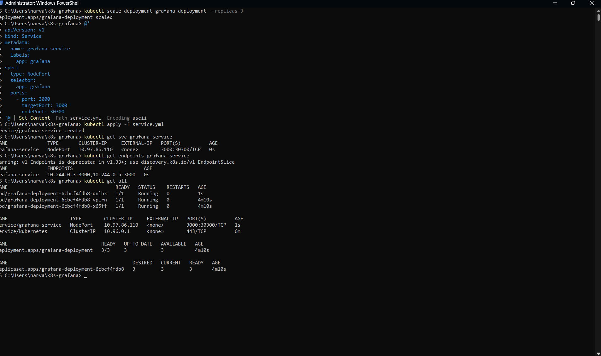
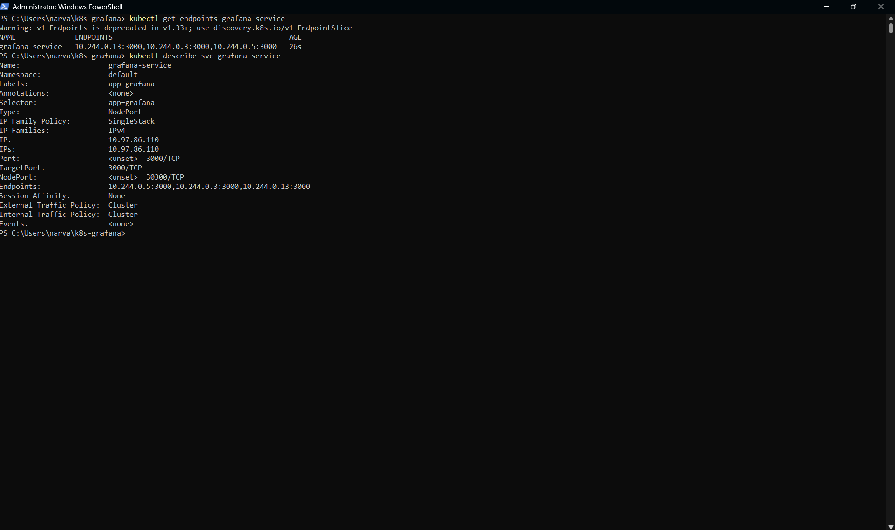
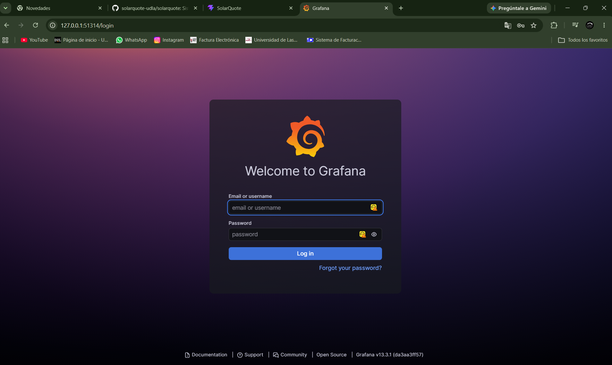
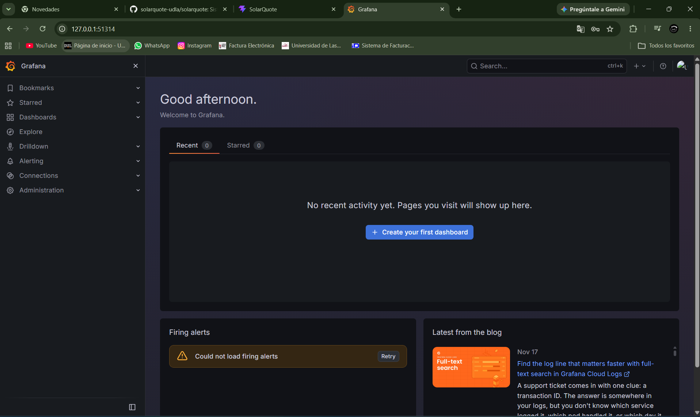
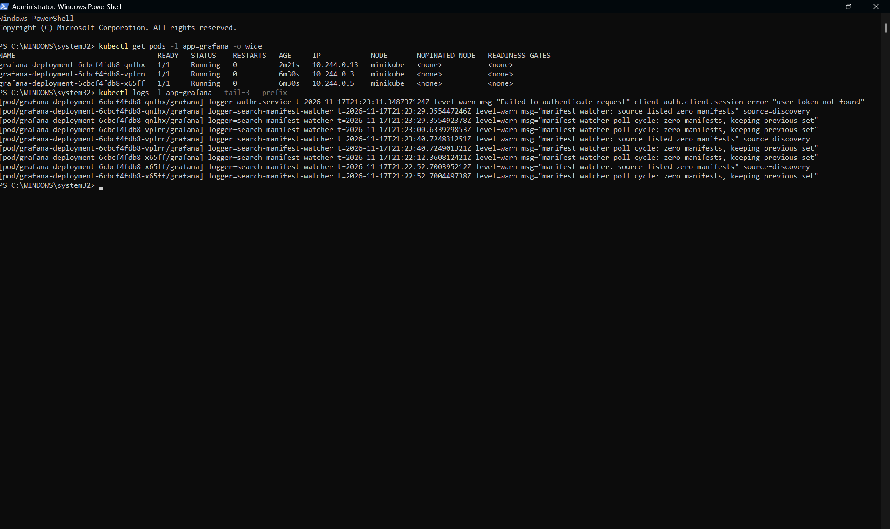
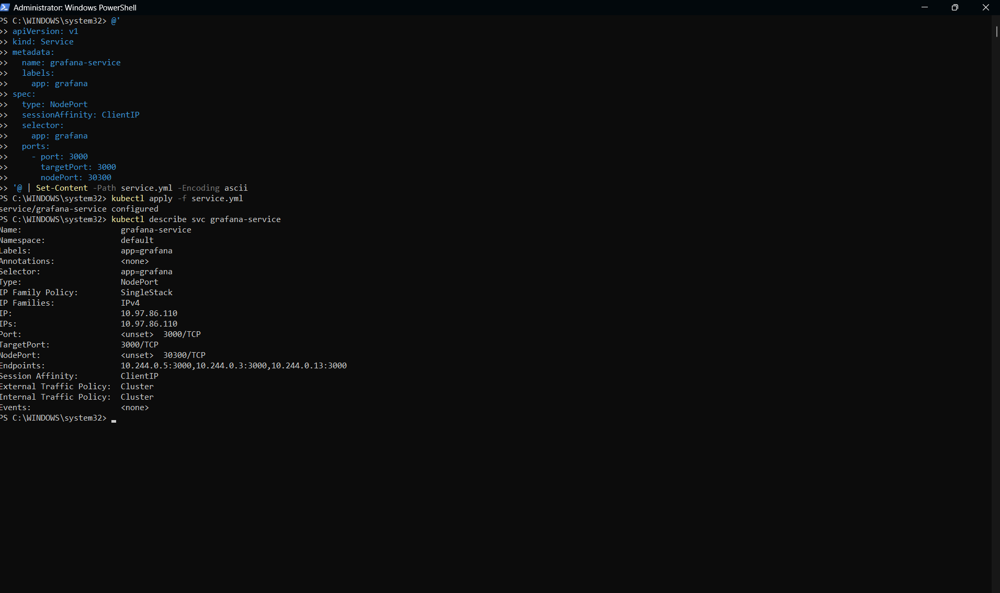

# Despliegue de Grafana en Kubernetes con Deployment y ReplicaSet

**Autor:** Esteban Narváez
**Universidad:** Universidad de Las Américas (UDLA), Quito, Ecuador
**Materia:** Configuración de cluster (Docker Swarm / Kubernetes)
**Repositorio:** https://github.com/Estebin21/k8s-grafana-deployment

## 1. Objetivo

Desplegar una plataforma distinta a la vista en clase (Grafana) en un clúster Kubernetes local, aplicando los conceptos de **Deployment** y **ReplicaSet**, y exponerla fuera del clúster mediante un **Service** de tipo NodePort.

## 2. Entorno

| Componente | Versión |
|---|---|
| Sistema operativo | Windows 11 Home |
| Docker Desktop | 29.9.3 (driver de minikube) |
| minikube | v1.39.0 |
| Kubernetes | v1.37.0 |
| Plataforma desplegada | Grafana v13.3.1 (`grafana/grafana:latest`) |

## 3. Archivos del repositorio

- `deployment.yml`: Deployment con 3 réplicas de Grafana.
- `service.yml`: Service NodePort que expone Grafana en el puerto 3000.
- `capturas/`: evidencias del proceso.

## 4. Conceptos aplicados

**Pod:** unidad mínima de ejecución. Aquí cada Pod ejecuta un contenedor de Grafana.

**ReplicaSet:** garantiza que siempre exista el número deseado de Pods idénticos. Si un Pod se elimina o falla, crea otro para reemplazarlo.

**Deployment:** gestiona el ReplicaSet de forma declarativa. Permite escalar, actualizar la imagen con *rolling update* y volver a una versión anterior. Al crear el Deployment, Kubernetes genera automáticamente el ReplicaSet y este los Pods.

**Service (NodePort):** da una dirección estable a un conjunto de Pods (seleccionados por la etiqueta `app: grafana`) y reparte el tráfico entre ellos. NodePort lo publica en un puerto del nodo.

```
Deployment (grafana-deployment)
   └── ReplicaSet (grafana-deployment-6cbcf4fdb8)
          ├── Pod grafana-...-qnlhx
          ├── Pod grafana-...-vplrn
          └── Pod grafana-...-x65ff
Service NodePort (grafana-service :30300) ──► los 3 Pods
```

## 5. Desarrollo paso a paso

### 5.1 Clúster minikube listo

```
minikube start --driver=docker
kubectl get nodes
```

El nodo `minikube` pasa de `NotReady` (recién creado) a `Ready`.



### 5.2 Definición del Deployment

Archivo `deployment.yml`: 3 réplicas, selector `app: grafana` y la imagen `grafana/grafana:latest` con el puerto 3000.

```
kubectl apply -f deployment.yml
kubectl rollout status deployment/grafana-deployment
kubectl get deployment
kubectl get replicaset
kubectl get pods -o wide
```

Resultado: Deployment `3/3`, un ReplicaSet con 3 Pods en `Running`.



### 5.3 Autorreparación con el ReplicaSet

Se eliminó un Pod manualmente:

```
kubectl delete pod <nombre-del-pod>
kubectl get pods
```

El ReplicaSet creó de inmediato un Pod nuevo para mantener las 3 réplicas deseadas.



### 5.4 Escalado

```
kubectl scale deployment grafana-deployment --replicas=5
kubectl scale deployment grafana-deployment --replicas=2
```

El Deployment ajusta el ReplicaSet hacia arriba (5) y hacia abajo (2). Después se volvió a 3 réplicas.



### 5.5 Exposición con Service NodePort

Archivo `service.yml`:

```
kubectl apply -f service.yml
kubectl get svc grafana-service
kubectl get endpoints grafana-service
kubectl describe svc grafana-service
```

El Service queda con `3000:30300/TCP` y 3 endpoints, uno por Pod.





### 5.6 Acceso desde el navegador

Con el driver Docker en Windows el NodePort no es accesible directamente, por lo que se usa el túnel de minikube:

```
minikube service grafana-service
```





### 5.7 Problema encontrado: sesiones con varias réplicas

Al iniciar sesión por primera vez, Grafana devolvía al login con el mensaje *Unauthorized*. Los logs de los Pods mostraron `Failed to authenticate request ... user token not found`.



**Causa:** cada Pod de Grafana guarda sus sesiones en su propia base de datos local (SQLite). El Service repartía las peticiones entre los 3 Pods, por lo que una sesión iniciada en un Pod no existía en los otros.

**Solución:** se agregó `sessionAffinity: ClientIP` al Service, de modo que un mismo cliente siempre llegue al mismo Pod.



Para producción, lo recomendable es usar una base de datos externa compartida (PostgreSQL o MySQL) y así mantener las réplicas sin estado.

## 6. Usos de Deployment y ReplicaSet

**Deployment**
- Despliegue declarativo de aplicaciones sin estado (APIs, sitios web, microservicios).
- Actualizaciones sin caída (*rolling update*) y reversión con `kubectl rollout undo`.
- Escalado manual o automático (con HPA) según la carga.
- Mantener el estado deseado de la aplicación versionado en archivos YAML (infraestructura como código).

**ReplicaSet**
- Alta disponibilidad: mantiene el número de réplicas aunque un Pod o un nodo falle.
- Balanceo de carga: varias réplicas atendidas por un mismo Service.
- Base interna del Deployment, que lo usa para gestionar versiones y actualizaciones.

**Usos de Grafana como plataforma**
- Monitoreo y visualización de métricas de infraestructura y aplicaciones (con Prometheus, Loki, etc.).
- Paneles de observabilidad para equipos de desarrollo y operaciones.
- Alertas sobre métricas críticas.

## 7. Conclusiones

- El Deployment simplifica la gestión: define el estado deseado y Kubernetes se encarga de mantenerlo.
- El ReplicaSet da autorreparación; al borrar un Pod se recreó solo en pocos segundos.
- El Service NodePort permite exponer la aplicación y repartir tráfico entre las réplicas.
- Al replicar aplicaciones con estado local, como Grafana con SQLite, hay que considerar la persistencia de sesiones, ya sea con afinidad de sesión o con una base de datos compartida.

## 8. Cómo reproducirlo

```
minikube start --driver=docker
kubectl apply -f deployment.yml
kubectl apply -f service.yml
minikube service grafana-service
```

Acceso inicial: usuario `admin`, contraseña `admin`.
